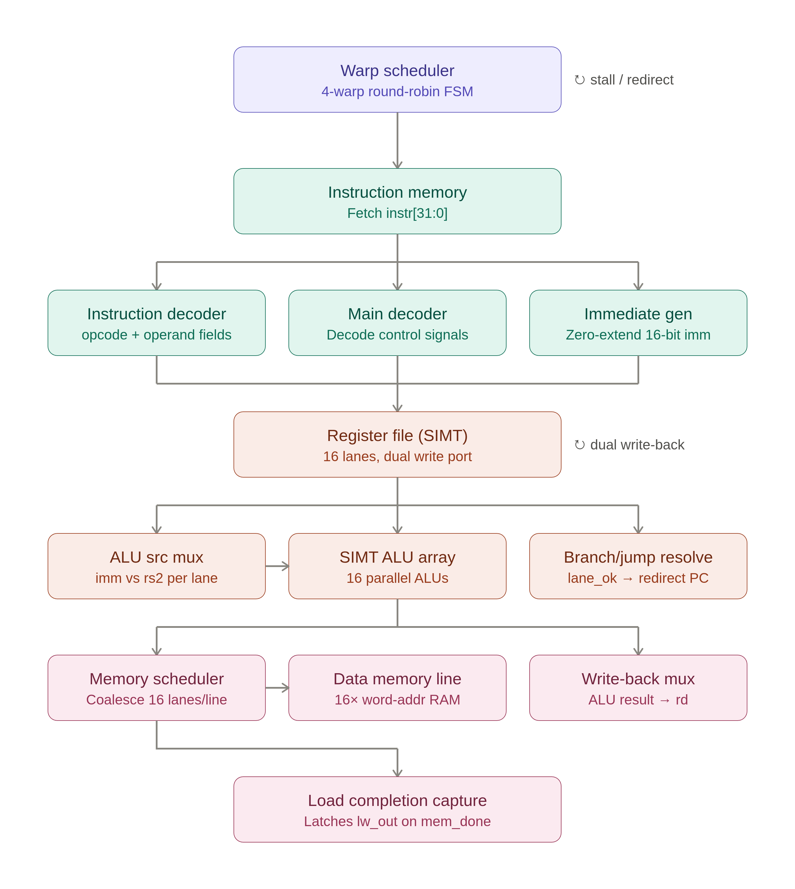
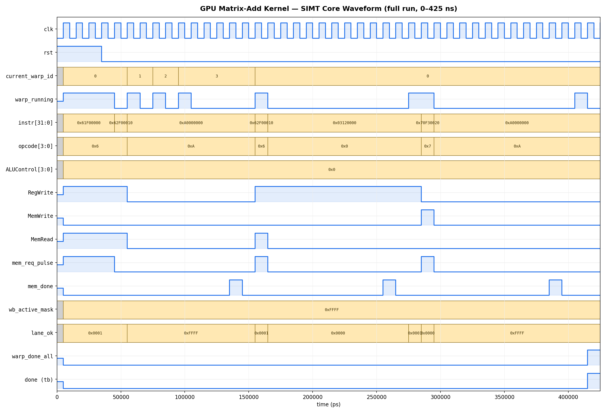
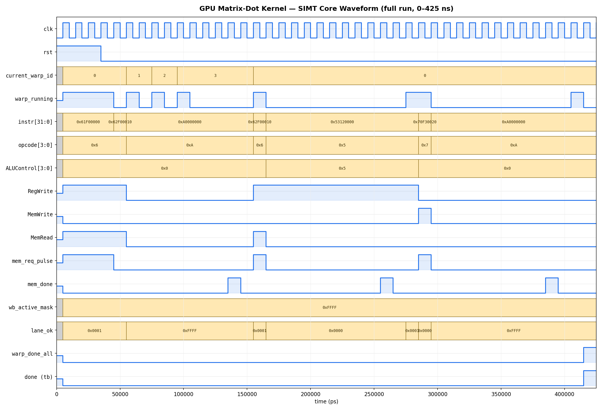
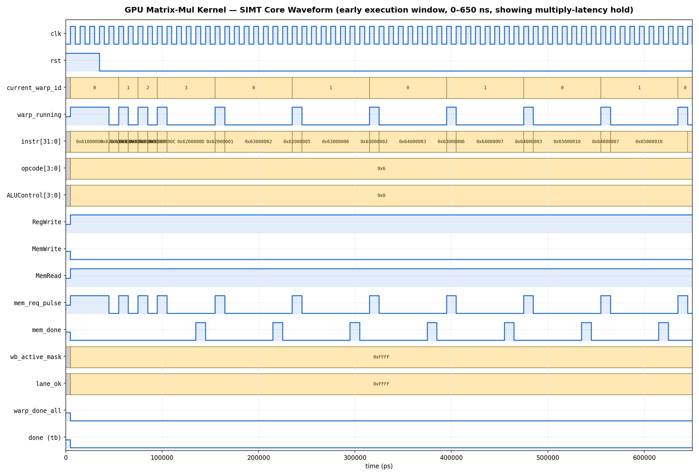

# SIMT GPU Architecture for Parallel Matrix Operations

A Verilog implementation of a **SIMT (Single Instruction Multiple Threads) GPU architecture** capable of executing parallel matrix kernels. The design includes a warp scheduler, SIMT ALU, coalesced memory subsystem, register file, and instruction execution pipeline.

The project demonstrates:

- Parallel **Matrix Addition (C = A + B)**
- Parallel **Matrix Dot Product / elementwise multiply (C = A ⊙ B)**
- Parallel **Matrix Multiplication (C = A × B)**
- Round-robin warp scheduling with stall detection and multi-warp latency hiding
- Memory coalescing across 16 SIMT lanes
- SIMT execution with per-lane register files
- Functional verification using VCD waveforms

---

## Features

- 16-lane SIMT execution engine
- 4-warp round-robin scheduler
- Per-lane 16-register file (R0 = zero, R15 = lane ID hardwired)
- Booth-encoded multiplier (signed, radix-2)
- Non-restoring signed integer divider
- Memory Scheduler with cache-line coalescing (16-word lines)
- 12-bit byte-addressable Data Memory
- Load/Store with automatic memory stall/resume
- Branch (BEQ) and unconditional Jump support
- Matrix Addition kernel
- Matrix Dot Product (elementwise multiply) kernel
- Matrix Multiplication kernel
- Complete Verilog testbenches with pass/fail checking
- GTKWave-compatible VCD generation

---

## Architecture




---

## Overall Data Flow

```text
              +-------------------+
              | Instruction Memory|
              +---------+---------+
                        |
                        v
             +----------------------+
             | Instruction Decoder  |
             +----------+-----------+
                        |
                        v
              +--------------------+
              | Warp Scheduler     |   <-- round-robin, stall/resume
              +----------+---------+
                         |
                         v
              +--------------------+
              | Register File      |   <-- 16 lanes × 16 regs; R15 = lane ID
              +----------+---------+
                         |
                         v
                  +--------------+
                  | SIMT ALU     |   <-- 16 parallel ALU instances
                  +------+-------+
                         |
             +-----------+------------+
             |                        |
             v                        v
       Write Back               Memory Scheduler
                                       |
                                 Coalesce requests
                                 from 16 lanes into
                                 cache-line bursts
                                       |
                                       v
                                 Data Memory
                               (12-bit, 32-bit wide)
```

---

## Project Structure

```text
├── rtl/
│   ├── gpu_top.v              # Top-level integration
│   ├── alu.v                  # Single-lane ALU with flags
│   ├── simt_alu.v             # 16× ALU array
│   ├── warp_scheduler.v       # 4-warp round-robin FSM
│   ├── memory_scheduler.v     # Coalescing memory FSM
│   ├── reg_file_simt.v        # 16-lane register file
│   ├── instruction_memory.v   # ROM loaded from .hex
│   ├── data_memory.v          # RAM with initialised matrices
│   ├── instruction_decoder.v  # Fixed-width instruction decode
│   ├── main_decoder.v         # Control-signal generation
│   ├── imm_gen.v              # Zero-extend 16-bit immediate
│   ├── writeback_mux.v        # ALU vs. load-data selection
|   └── script.sh 
│
├── tests/
│   ├── tb_matrix_add.v        # Matrix addition testbench
│   ├── tb_matrix_mul.v        # Matrix multiplication testbench
|   ├── tb_matrix_dot.v        # Matrix dot product testbench
│
├── programs/
│   ├── matrix_add.mem         # Assembled addition kernel
│   ├── matrix_mul.mem         # Assembled multiplication kernel
|   ├── matrix_dot.hex         # Assembled dot product kernel
│
├── waves/
│   ├── tb_matrix_add.vcd      # Addition simulation trace
│   ├── tb_matrix_mul.vcd      # Multiplication simulation trace
|   └── tb_matrix_dot.vcd      # Dot product simulation trace 
│
└── README.md
```

---

## Module Reference

### `gpu_top.v` — Top-Level Integration

Instantiates and wires every sub-module. Key responsibilities:

- Drives `mem_req_pulse` from the current instruction's opcode, gating on `mem_pending` and `ms_stall`.
- Tracks per-warp `mem_pending`, `mem_is_load`, and `mem_dest` in four registers.
- Latches `lw_out` into `captured_lw_data` when `mem_done` fires and the request was a load.
- Generates write-back control: on a load completion, `wb_rd_addr` comes from the captured destination; otherwise it comes from the decoded `rd` field.
- Implements BEQ/Jump redirection: all 16 `lane_ok` bits must agree before the PC is redirected.

### `warp_scheduler.v` — 4-Warp Round-Robin FSM

States: **RUN → SWITCH → RUN**

| Signal | Direction | Description |
|--------|-----------|-------------|
| `mem_req` | in | Memory op issued; stall this warp |
| `mem_done` | in | Memory op complete; un-stall the warp |
| `halt` | in | Mark current warp finished |
| `hold` | in | Freeze PC (bubble; do not advance) |
| `redirect` | in | BEQ/Jump taken; load `pc_target` |
| `warp_ready` | out | PC of the currently scheduled warp |
| `warp_ready_mask` | out | Active-lane mask (always `0xFFFF` here) |
| `done` | out | All four warps finished |

Warp initial PCs (set in `initial` block):

| Warp | Start PC |
|------|----------|
| 0 | 0 |
| 1 | 64 |
| 2 | 128 |
| 3 | 192 |

On `mem_req`, the warp's PC is **immediately advanced by 1** before the warp is stalled. This ensures the warp resumes at the correct instruction after memory completes, avoiding the re-issue bug.

### `reg_file_simt.v` — 16-Lane Register File

- 16 registers per lane (4-bit address)
- **R0** always reads as zero and is never written
- **R15** is hardwired to the lane index (0–15); writes are silently ignored
- All 16 lanes share a single `rd_addr` / `rs1_addr` / `rs2_addr`; per-lane data diverges in the data arrays
- `active_mask` gates writes: a lane whose mask bit is 0 retains its register value

### `alu.v` — Single-Lane ALU

Supports:

| `ALUControl` | Operation | Notes |
|---|---|---|
| `0000` | ADD | |
| `0001` | SUB | Two's complement via B-invert + carry-in |
| `0010` | AND | |
| `0011` | OR | |
| `0100` | XOR | |
| `0101` | MUL (low 16 bits) | Via Booth multiplier |
| `0110` | MUL (high 16 bits) | Upper half of 32-bit product |
| `0111` | DIV (quotient) | Non-restoring signed divider |
| `1000` | REM (remainder) | Non-restoring signed divider |
| `1001` | SLT | Sign-aware set-less-than |

Flags produced: `zero`, `carry`, `negative`, `overflow`, `divide_by_zero`.


### `simt_alu.v` — 16-Lane ALU Array

Instantiates 16 copies of `alu.v`, each receiving its own `A[i]` / `B[i]` while sharing the `ALUControl` bus. Results emerge independently per lane.

### `memory_scheduler.v` — Coalescing Memory FSM

States: **IDLE → WARP → REQ\_CHECK → REQ → WAIT → CAPTURE → DONE**

Accepts memory requests from the warp scheduler, queues up to **4 outstanding requests** (one per warp), then services them one cache line at a time.

**Coalescing algorithm (REQ state):**
1. Find the first un-serviced active lane (the "leader").
2. Collect all other active lanes whose address falls in the **same 16-word cache line** as the leader (upper 8 bits of the 12-bit address).
3. Issue one `addr_out` to `data_memory_line`, writing or reading all matched lanes in a single memory transaction.
4. Mark those lanes as serviced; loop back for remaining lanes.

On a store, `sw_word_mask` selects only the words within the cache line that belong to the coalesced group, so unrelated words are not overwritten.

### `data_memory.v` / `data_memory_line.v` — Data Memory

`data_memory`: Single-port synchronous RAM, 4096 × 32-bit words (12-bit address).

`data_memory_line`: Generates 16 parallel `data_memory` instances sharing an upper-address bus, forming a 16-word cache line interface. Each word is individually write-enabled via `sw_word_mask`.

Pre-loaded layout:

| Address range | Contents |
|---|---|
| 0 – 15 | Matrix A (values 1–16, row-major) |
| 16 – 31 | Matrix B (4×4 identity matrix) |
| 100 – 115 | Row index table (0,0,0,0, 1,1,1,1, 2,2,2,2, 3,3,3,3) |
| 116 – 131 | Column index table (0,1,2,3 repeating) |
| 200 | Constant 32 (base address of output matrix C) |

### `instruction_decoder.v` — Fixed-Width Decode

Instruction word is 32 bits wide:

```
 31      28 27    24 23    20 19    16 15               0
 +--------+--------+--------+--------+-----------------+
 | opcode |   rd   |   rs1  |   rs2  |    immediate    |
 +--------+--------+--------+--------+-----------------+
    4 b       4 b     4 b      4 b         16 b
```

### `main_decoder.v` — Control Signal Generation

| Opcode | Mnemonic | RegWrite | MemRead | MemWrite | ALUSrc | ALUControl |
|--------|----------|----------|---------|----------|--------|------------|
| `0x0` | ADD | 1 | 0 | 0 | 0 | 0000 |
| `0x1` | SUB | 1 | 0 | 0 | 0 | 0001 |
| `0x2` | AND | 1 | 0 | 0 | 0 | 0010 |
| `0x3` | OR | 1 | 0 | 0 | 0 | 0011 |
| `0x4` | XOR | 1 | 0 | 0 | 0 | 0100 |
| `0x5` | MUL | 1 | 0 | 0 | 0 | 0101 |
| `0x6` | LW | 1 | 1 | 0 | 1 | 0000 |
| `0x7` | SW | 0 | 0 | 1 | 1 | 0000 |
| `0x8` | BEQ | 0 | 0 | 0 | 0 | 0001 |
| `0x9` | JUMP | 0 | 0 | 0 | — | — |
| `0xA` | HALT | 0 | 0 | 0 | — | — |

---

## Instruction Set Summary

```
ADD   rd, rs1, rs2   →  rd = rs1 + rs2
SUB   rd, rs1, rs2   →  rd = rs1 - rs2
AND   rd, rs1, rs2   →  rd = rs1 & rs2
OR    rd, rs1, rs2   →  rd = rs1 | rs2
XOR   rd, rs1, rs2   →  rd = rs1 ^ rs2
MUL   rd, rs1, rs2   →  rd = (rs1 × rs2)[15:0]
LW    rd, rs1, imm   →  rd = Mem[rs1 + imm]
SW    rs2, rs1, imm  →  Mem[rs1 + imm] = rs2
BEQ   rs1, rs2, imm  →  if (rs1 == rs2) PC += 1 + imm
JUMP  imm            →  PC = imm
HALT                 →  Mark warp complete
```

Immediates are **zero-extended** to 16 bits by `imm_gen.v`.

---

## Matrix Addition

The addition kernel computes

$$C = A + B$$

where every lane computes one matrix element in parallel — all 16 elements complete in a single warp pass.

### Input Matrices

**Matrix A** (addresses 0–15):

| 1 | 2 | 3 | 4 |
|---|---|---|---|
| 5 | 6 | 7 | 8 |
| 9 | 10 | 11 | 12 |
| 13 | 14 | 15 | 16 |

**Matrix B** (addresses 16–31, identity matrix):

| 1 | 0 | 0 | 0 |
|---|---|---|---|
| 0 | 1 | 0 | 0 |
| 0 | 0 | 1 | 0 |
| 0 | 0 | 0 | 1 |

### Output Matrix C (addresses 32–47):

| 2 | 2 | 3 | 4 |
|---|---|---|---|
| 5 | 7 | 7 | 8 |
| 9 | 10 | 12 | 12 |
| 13 | 14 | 15 | 17 |

### Instruction Trace (decoded from `instr[31:0]`)

Every lane runs the exact same four instructions — only the per-lane address (`R15` = lane ID) and per-lane data differ:

| Time | Instruction | Meaning |
|------|-------------|---------|
| 5 ns | `LW  R1, R15, 0`  | each lane loads `A[lane_id]` (addr 0–15) — one coalesced 16-word burst |
| 155 ns | `LW  R2, R15, 16` | each lane loads `B[lane_id]` (addr 16–31) — one coalesced 16-word burst |
| 165 ns | `ADD R3, R1, R2` | 16-lane parallel element-wise add |
| 285 ns | `SW  R3, R15, 32` | each lane stores its result to `C[lane_id]` (addr 32–47) — one coalesced 16-word burst |

### Kernel Execution Trace

The warp scheduler issues Warp 0 first. Warps 1–3 execute a single `HALT` (placeholder warps at PCs 64/128/192) and retire almost immediately, leaving Warp 0 as the sole warp doing real work.

| Phase | Opcode | Description |
|-------|--------|-------------|
| 1 | LW | Load all 16 elements of Matrix A into registers (16 lanes simultaneously) |
| 2 | LW | Load all 16 elements of Matrix B |
| 3 | ADD | 16-lane parallel element-wise add |
| 4 | SW | Store all 16 results to Matrix C base address 32 |
| 5 | HALT | Mark Warp 0 complete; `done` asserted |

---

## Matrix Dot Product (Elementwise Multiply)

`tb_matrix_dot` runs the **identical instruction stream as Matrix Addition**, with a single field changed: the ALU op is `MUL` instead of `ADD`. The result is a 16-lane parallel **elementwise (Hadamard) product**, C = A ⊙ B, rather than a reduction-style dot product:

$$C[i][j] = A[i][j] \times B[i][j]$$

Because the test's **B** matrix is the 4×4 identity, every off-diagonal entry of B is `0`, so the elementwise product zeroes out everything except the diagonal of A — which is exactly what the simulation prints. This makes the kernel a clean, minimal-cycle way to exercise the MUL datapath (Booth multiplier) end-to-end without the multi-iteration accumulation loop that full matrix multiplication requires.

### Input Matrices

**Matrix A** (addresses 0–15):

| 1 | 2 | 3 | 4 |
|---|---|---|---|
| 5 | 6 | 7 | 8 |
| 9 | 10 | 11 | 12 |
| 13 | 14 | 15 | 16 |

**Matrix B** (addresses 16–31, identity matrix):

| 1 | 0 | 0 | 0 |
|---|---|---|---|
| 0 | 1 | 0 | 0 |
| 0 | 0 | 1 | 0 |
| 0 | 0 | 0 | 1 |

### Output Matrix C = A ⊙ B (addresses 32–47):

| 1 | 0 | 0 | 0 |
|---|---|---|---|
| 0 | 6 | 0 | 0 |
| 0 | 0 | 11 | 0 |
| 0 | 0 | 0 | 16 |

### Instruction Trace (decoded from `instr[31:0]`)

| Time | Instruction | Meaning |
|------|-------------|---------|
| 5 ns | `LW  R1, R15, 0`  | each lane loads `A[lane_id]` — one coalesced burst |
| 155 ns | `LW  R2, R15, 16` | each lane loads `B[lane_id]` — one coalesced burst |
| 165 ns | `MUL R3, R1, R2` | 16-lane parallel elementwise multiply (Booth) |
| 285 ns | `SW  R3, R15, 32` | each lane stores its result — one coalesced burst |

### Kernel Execution Trace

| Phase | Opcode | Description |
|-------|--------|-------------|
| 1 | LW | Load all 16 elements of Matrix A |
| 2 | LW | Load all 16 elements of Matrix B |
| 3 | MUL | 16-lane parallel elementwise multiply |
| 4 | SW | Store all 16 results (only the 4 diagonal lanes are non-zero) |
| 5 | HALT | Mark Warp 0 complete; `done` asserted |

Because the instruction stream, memory-access pattern, and warp-scheduling behavior are identical to Matrix Addition (only the `ALUControl` value differs), the timing trace is bit-for-bit identical to the addition kernel: **42 clock cycles, 425 ns runtime.**

### Warp Execution Summary

```
W0: LW (A) → stall/resume → LW (B) → stall/resume → MUL → SW → stall/resume → HALT
W1: HALT  (placeholder)
W2: HALT  (placeholder)
W3: HALT  (placeholder)
```

### Execution Metrics

| Metric | Value |
|--------|------:|
| Clock Cycles | 42 |
| Runtime | 425 ns |
| Memory Transactions | 3 (2 LW + 1 SW) |
| Coalescing Ratio | 16:1 (16 lanes per transaction) |
| ALU Cycles | 1 (single parallel MUL) |

---

## Matrix Multiplication

The multiplication kernel computes

$$C = A \times B$$

For the supplied test case, B is the identity matrix, so:

$$C = A \times I = A$$

### Output Matrix C:

| 1 | 2 | 3 | 4 |
|---|---|---|---|
| 5 | 6 | 7 | 8 |
| 9 | 10 | 11 | 12 |
| 13 | 14 | 15 | 16 |

### Kernel Execution Trace

Matrix multiplication requires dot products: for each output element C[i][j], the kernel iterates over the inner dimension (k = 0…3), performing a multiply-accumulate:

```
accumulator = 0
for k in 0..3:
    accumulator += A[i][k] * B[k][j]
C[i][j] = accumulator
```

This inner loop requires repeated LW → MUL → ADD cycles, which accounts for the significantly higher cycle count compared to addition. Unlike the addition/dot-product kernels, **all four warps do real work here** — the scheduler round-robins continuously between Warp 0 and Warp 1 (and, later in the run, Warp 2 and Warp 3) for the full length of the simulation, overlapping each warp's multiply/memory latency with another warp's progress instead of leaving three warps idle.

| Phase | Opcode(s) | Description |
|-------|-----------|-------------|
| 1 | LW | Load A[i][k] for current k iteration |
| 2 | LW | Load B[k][j] for current k iteration |
| 3 | MUL | 16-lane parallel multiply (Booth) |
| 4 | ADD | Accumulate into result register |
| 5 | BEQ/JUMP | Loop back for next k; exit when k == 4 |
| 6 | SW | Store accumulated result for that output element |
| 7 | HALT | Warp complete |

---

## Simulation Results

All three kernels execute correctly and produce matching output.

| Test | Clock Cycles | Runtime | Result |
|------|:---:|:---:|:---:|
| Matrix Addition | 42 | 425 ns | **PASS** |
| Matrix Dot Product (elementwise) | 42 | 425 ns | **PASS** |
| Matrix Multiplication | 843 | 8435 ns | **PASS** |

---

## Waveform Analysis — Matrix Addition



**File:** `tb_matrix_add.vcd` · **Tool:** GTKWave · **Timescale:** 1 ns/1 ps

### Key Events

| Time | Event | Signal(s) |
|------|-------|-----------|
| 0 ns | Simulation start; reset asserted | `rst = 1` |
| 35 ns | Reset released | `rst = 0` |
| 5 ns | Warp 0 scheduled; first LW issued | `current_warp_id = W0`, `opcode = LW` |
| 55–95 ns | W1, W2, W3 each execute their HALT | `opcode = HALT` for placeholder warps |
| 155 ns | Warp 0 resumes; second LW (Matrix B) | `opcode = LW`, `mem_req_pulse` rises |
| 165 ns | ADD instruction dispatched | `opcode = ADD`; 16 ALUs add in parallel |
| 285 ns | SW request issued | `opcode = SW`, `mem_req_pulse` rises |
| 345 ns | Coalesced store fires: 16 lanes → **1 memory transaction** | `ms_mem_write = 1`, `addr = 32` |
| 405 ns | Warp 0 executes HALT | `opcode = HALT` |
| 415 ns | `done` asserted; kernel complete | `done = 1` |
| 425 ns | `$finish` | — |

### Warp Execution Summary

```
W0: LW (A) → stall/resume → LW (B) → stall/resume → ADD → SW → stall/resume → HALT
W1: HALT  (placeholder)
W2: HALT  (placeholder)
W3: HALT  (placeholder)
```

Round-robin scheduling is visible in the `current_warp_id` trace: W0 → W1 → W2 → W3 → W0, with W1/W2/W3 retiring almost immediately.

### Execution Metrics

| Metric | Value |
|--------|------:|
| Clock Cycles | 42 |
| Runtime | 425 ns |
| Memory Transactions | 3 (2 LW + 1 SW) |
| Coalescing Ratio | 16:1 (16 lanes per transaction) |
| ALU Cycles | 1 (single parallel ADD) |

The Matrix Dot Product waveform (`tb_matrix_dot.vcd`) is bit-for-bit identical in timing to this trace — see the [Matrix Dot Product](#matrix-dot-product-elementwise-multiply) section above for its own waveform and instruction decode.



---

## Waveform Analysis — Matrix Multiplication



**File:** `tb_matrix_mul.vcd` · **Tool:** GTKWave · **Timescale:** 1 ns/1 ps

### Key Events

| Time | Event | Signal(s) |
|------|-------|-----------|
| 0 ns | Simulation start; reset asserted | `rst = 1` |
| 35 ns | Reset released | `rst = 0` |
| 5–95 ns | Warps 0, 1, 2, 3 all scheduled in for the first time | `current_warp_id` cycles 0→1→2→3 |
| 5 ns – 8355 ns | Continuous round-robin between warps, each running its own LW → LW → MUL → ADD → BEQ inner loop | `current_warp_id` toggles ~96 times; `mem_req_pulse` fires 98 times |
| 1455–8355 ns | 16 separate coalesced store bursts, one every few hundred ns as each output element's accumulation finishes | `ms_mem_write = 1` (×16) |
| ~8415 ns | Final HALT | `opcode = HALT` |
| 8425 ns | `done` asserted | `done = 1` |
| 8435 ns | `$finish` | — |

### `mem_req_pulse` Activity

The multiplication waveform shows **98 `mem_req_pulse` assertions** across the full simulation (measured directly from the VCD: 82 loads + 16 stores). Each pulse corresponds to one warp issuing a memory operation and stalling until the memory scheduler completes it. Unlike addition/dot-product — where all 16 lanes' results land in a single coalesced store — multiplication's output elements finish their accumulation at different times, so the **16 output elements are written back in 16 separate coalesced store bursts** rather than one combined transaction.

### Execution Metrics

| Metric | Value |
|--------|------:|
| Clock Cycles | 843 |
| Runtime | 8435 ns |
| Memory Requests (`mem_req_pulse`) | 98 (82 loads + 16 stores) |
| Store Transactions (`ms_mem_write`) | 16 (one per output element) |
| Multiply Iterations | 4 per output element (inner loop k = 0–3) |
| Warps Actively Computing | 4 (round-robin throughout, not just Warp 0) |
| Coalescing Ratio | 16:1 per transaction |
| Cycles vs. Addition | ~20× more cycles (reduction loop + 4 warps interleaved) |

---

## Memory Coalescing — Detailed

The `memory_scheduler` combines accesses from multiple SIMT lanes that fall within the same **16-word cache line** into a single memory transaction.

### How It Works

1. A warp issues a memory instruction. `gpu_top` fires `mem_req_pulse` and latches the 16 per-lane addresses into the scheduler's request queue.
2. The scheduler enters the **WARP** state and picks the next pending warp.
3. In **REQ**, it scans active lanes for a "leader" (first un-serviced lane). It finds all lanes whose `addr[15:4]` (upper bits) match the leader's — these form a coalesced group.
4. It issues a single `addr_out` to `data_memory_line`. For stores, `sw_word_mask` enables only the relevant word slots within the line.
5. After **WAIT** + **CAPTURE**, the loaded data is distributed back to the correct per-lane slots in `lw_out`.
6. The REQ loop repeats for any remaining un-serviced lanes (different cache lines), then enters **DONE** and signals `mem_done` to the warp scheduler.

### Benefits

| Benefit | Detail |
|---------|--------|
| Reduced memory traffic | 16 logical accesses → 1 physical transaction when all lanes are in the same cache line |
| Improved bandwidth | Full cache-line utilisation on every transaction |
| Lower latency | One scheduler FSM cycle instead of 16 sequential accesses |
| Higher throughput | Enables full-warp load/store in constant cycles regardless of lane count |

Note that this benefit is fully realised in the addition and dot-product kernels (single-pass, single coalesced store), but only partially realised in matrix multiplication, where each output element completes its own accumulation loop at a different time — resulting in 16 separate store bursts instead of one.

---

## Test Output

### Matrix Addition

```
==================== MATRIX A ====================
     1    2    3    4 
     5    6    7    8 
     9   10   11   12 
    13   14   15   16 
==================== MATRIX B ====================
     1    0    0    0 
     0    1    0    0 
     0    0    1    0 
     0    0    0    1 
==================== MATRIX C ====================
  (Expected vs Actual)
  +-------------+-------------+
  |  Expected   |   Actual    |
  +-------------+-------------+
  +-------------+-------------+
  |           2 |           2 |
  |           2 |           2 |
  |           3 |           3 |
  |           4 |           4 |
  |             |             |
  +-------------+-------------+
  |           5 |           5 |
  |           7 |           7 |
  |           7 |           7 |
  |           8 |           8 |
  |             |             |
  +-------------+-------------+
  |           9 |           9 |
  |          10 |          10 |
  |          12 |          12 |
  |          12 |          12 |
  |             |             |
  +-------------+-------------+
  |          13 |          13 |
  |          14 |          14 |
  |          15 |          15 |
  |          17 |          17 |
  +-------------+-------------+
=== Matrix Addition: PASS ===
../tests/tb_matrix_add.v:114: $finish called at 425000 (1ps)
```

### Matrix Dot Product

```
==================== MATRIX A ====================
     1    2    3    4 
     5    6    7    8 
     9   10   11   12 
    13   14   15   16 
==================== MATRIX B ====================
     1    0    0    0 
     0    1    0    0 
     0    0    1    0 
     0    0    0    1 
==================== MATRIX C ====================
  (Expected vs Actual)
  +-------------+-------------+
  |  Expected   |   Actual    |
  +-------------+-------------+
  +-------------+-------------+
  |           1 |           1 |
  |           0 |           0 |
  |           0 |           0 |
  |           0 |           0 |
  |             |             |
  +-------------+-------------+
  |           0 |           0 |
  |           6 |           6 |
  |           0 |           0 |
  |           0 |           0 |
  |             |             |
  +-------------+-------------+
  |           0 |           0 |
  |           0 |           0 |
  |          11 |          11 |
  |           0 |           0 |
  |             |             |
  +-------------+-------------+
  |           0 |           0 |
  |           0 |           0 |
  |           0 |           0 |
  |          16 |          16 |
  +-------------+-------------+
=== Matrix Dot Product: PASS ===
../tests/tb_matrix_dot.v:114: $finish called at 425000 (1ps)
```

### Matrix Multiplication

```
==================== MATRIX A ====================
     1    2    3    4 
     5    6    7    8 
     9   10   11   12 
    13   14   15   16 
==================== MATRIX B ====================
     1    0    0    0 
     0    1    0    0 
     0    0    1    0 
     0    0    0    1 
==================== MATRIX C ====================
  (Expected vs Actual)
  +-------------+-------------+
  |  Expected   |   Actual    |
  +-------------+-------------+
  +-------------+-------------+
  |           1 |           1 |
  |           2 |           2 |
  |           3 |           3 |
  |           4 |           4 |
  |             |             |
  +-------------+-------------+
  |           5 |           5 |
  |           6 |           6 |
  |           7 |           7 |
  |           8 |           8 |
  |             |             |
  +-------------+-------------+
  |           9 |           9 |
  |          10 |          10 |
  |          11 |          11 |
  |          12 |          12 |
  |             |             |
  +-------------+-------------+
  |          13 |          13 |
  |          14 |          14 |
  |          15 |          15 |
  |          16 |          16 |
  +-------------+-------------+
=== Matrix Multiplication: PASS ===
../tests/tb_matrix_mul.v:105: $finish called at 8435000 (1ps)
```

---

## Running the Simulation

### Prerequisites

- Icarus Verilog (`iverilog`) or any standard Verilog-2005 simulator
- GTKWave (for waveform viewing)

### Compile and Simulate

```bash
# Matrix Addition
./script.sh -o add

# Matrix Multiplication
./script.sh -o mul

# Matrix Dot Product
./script.sh -o dot
```

### View Waveforms

```bash
gtkwave waves/tb_matrix_add.vcd
gtkwave waves/tb_matrix_mul.vcd
gtkwave waves/tb_matrix_dot.vcd
```

Suggested signals to add in GTKWave:

```
clk
rst
current_warp_id[1:0]
opcode[3:0]
mem_req_pulse
ms_mem_write
ms_addr_out[15:0]
done
```

---

## Performance Analysis

### Matrix Addition vs. Dot Product vs. Multiplication

| Metric | Addition | Dot Product | Multiplication |
|--------|:---:|:---:|:---:|
| Clock cycles | 42 | 42 | 843 |
| Runtime | 425 ns | 425 ns | 8435 ns |
| Memory requests (`mem_req_pulse`) | 3 | 3 | 98 |
| Store transactions (`ms_mem_write`) | 1 | 1 | 16 |
| ALU op | 1 ADD | 1 MUL | 4 MUL + 4 ADD (per element) |
| Inner loop iterations | — | — | 4 (per element) |
| Warps doing real work | 1 (W0) | 1 (W0) | 4 (round-robin) |
| Parallelism | 16 lanes / op | 16 lanes / op | 16 lanes / op |

Despite the inner loop, all 16 output elements still compute **in parallel** within each loop iteration. The much higher cycle count for multiplication reflects the sequential accumulation loop and the fact that all four warps are kept busy for the whole run — not a reduction in per-cycle parallelism.

### Coalescing Efficiency

Addition and dot-product achieve **16:1 coalescing** on every load and store (3 transactions total each) because all 16 lanes access a contiguous 16-element block that fits exactly in one 16-word cache line. Matrix multiplication also coalesces each individual load/store to 16:1, but because its 16 output elements finish their accumulation loops at different times, the final write-back is split into **16 separate coalesced store transactions** instead of one combined burst.

---

## Future Improvements

- Branch divergence handling (per-lane active mask modification)
- L1 cache hierarchy to hide multi-cycle memory latency
- Shared memory (scratchpad) for warp-level data exchange
- Pipelined execution to overlap instruction stages
- Floating-point ALU (IEEE 754 single-precision)
- Tensor core instructions (4×4 matrix multiply-accumulate in one op)
- Multiple Streaming Multiprocessors (SMs) with inter-SM synchronisation
- Configurable warp count and lane width via parameters

---

## Author

**Bibhav Jha**
**Saurab Poudel**

Designed for parallel matrix computation, warp scheduling, and memory coalescing demonstrations.